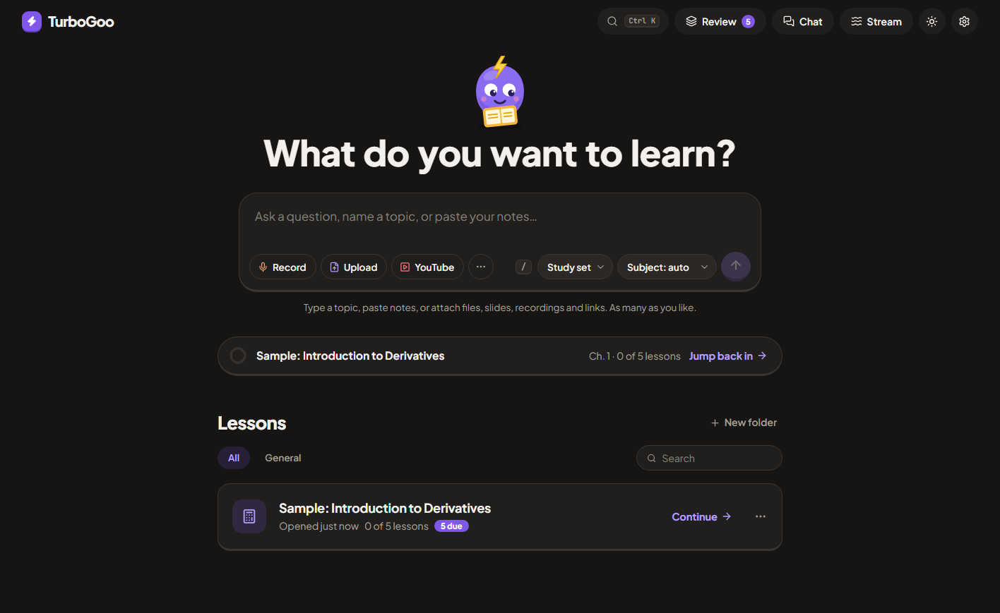
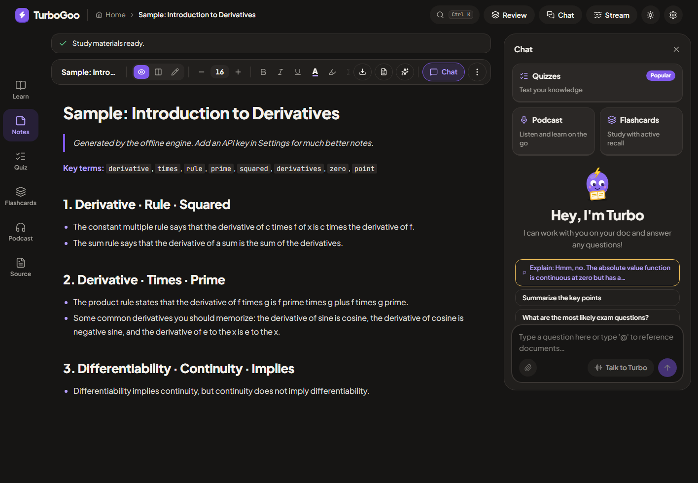
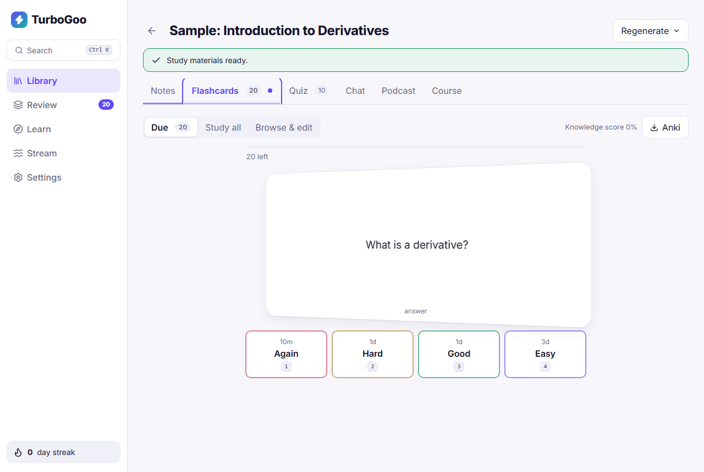
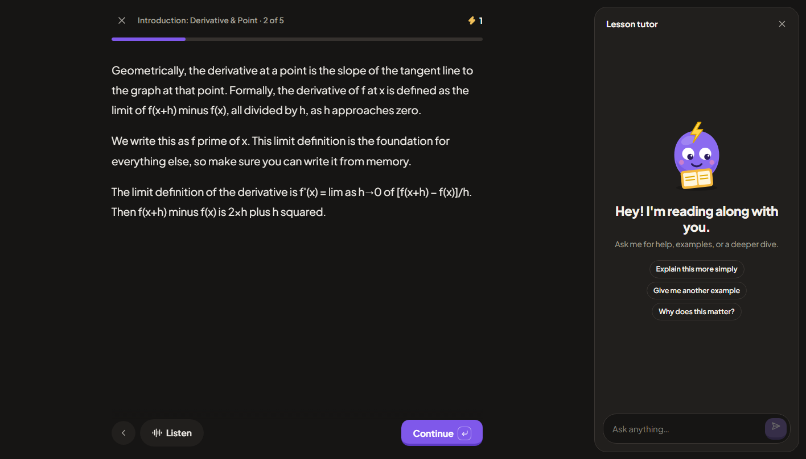

# TurboGoo ⚡

A local-first AI study workspace inspired by Turbo AI, tuned for **CBSE Class 10**. Turn lectures, PDFs, slides, videos and topics into short notes, flashcards, a quiz, a two-host podcast and a full lesson-by-lesson course. Everything is stored on your device; there is no TurboGoo server and no paywall.



| Notes with the docked Chat panel | Spaced-repetition flashcards | Paged lesson player with tutor |
| --- | --- | --- |
|  |  |  |

## Run it

```bash
npm install
npm run dev        # http://localhost:5173
npm run build      # typecheck + production build
```

It works immediately in **offline mode** (a basic built-in engine). For real quality, open **Settings** and connect any OpenAI-compatible provider. The default is **Vercel AI Gateway** with the free `nvidia/nemotron-3.5-lightning-free` model: paste your AI Gateway API key and you're set. OpenAI, OpenRouter, NVIDIA NIM, Groq, Gemini, Together, or local Ollama also work. Your key stays on your device and is sent only to the Base URL you set.

## Desktop app (Windows / macOS / Linux)

The desktop app is the same UI in an Electron shell, and it fixes the two main limits of the website:

- **YouTube import works reliably.** Captions are fetched from *your* connection instead of a cloud server, which YouTube blocks.
- **Any AI provider works** (NVIDIA NIM, Groq, OpenRouter, local Ollama or LM Studio) without CORS or `OLLAMA_ORIGINS` setup. NVIDIA NIM in particular does not allow browser requests, so it only works here.

```bash
npm run desktop       # build and launch the app
npm run dist:win      # installer in release/  (TurboGoo-Setup-x.y.z.exe)
npm run dist:mac      # .dmg   (build on a Mac)
npm run dist:linux    # .AppImage   (build on Linux)
```

On Windows, `scripts/launch-turbogoo.ps1` rebuilds and opens the app; point a desktop shortcut at it with `powershell -NoProfile -ExecutionPolicy Bypass -File scripts\launch-turbogoo.ps1`.

Pushing a tag like `v0.1.0` runs `.github/workflows/release.yml`, which builds all three installers and attaches them to a GitHub Release. Builds are **unsigned**: Windows shows a one-time SmartScreen warning ("More info → Run anyway") and macOS needs right-click → Open the first time. Add signing certificates as repository secrets to remove those warnings.

Security model: the app is served from a custom `turbogoo://` origin (no network port is opened), the renderer is sandboxed with no Node access, a strict Content-Security-Policy applies, only the microphone permission is granted (to exact-origin matches only), and links open in your normal browser. Your API keys stay in the app's local storage and go only to the provider you configure.

## Features

**Capture**
- One composer on the home page: type a topic, paste notes, or attach **any number of sources** (files, YouTube links, pasted text, existing library docs) and build one study set, a course or a chat from all of them
- Upload PDF, Word (.docx), PowerPoint (.pptx), .txt/.md, .srt/.vtt, images (OCR) or audio/video
- YouTube import by link (falls back to pasting from "Show transcript")
- Live lecture recording: live transcript, mic level meter, pause/resume, "flag ?" for confusing moments, audio saved to disk every 5 s with **crash recovery**, original audio kept next to the notes

**Subject-aware, built for CBSE Class 10**
- Pick a subject on the home screen (**Maths, Science, Social Science, English, Hindi, IT**) or leave it on *auto* and it is detected from your material. You can change it later in the document header.
- Each subject has its own instructions for notes, flashcards, quizzes, chat and course lessons. For example: Maths notes give the formula, when to use it and a worked example in board style (Given, To find, Solution, Hence); Science asks for balanced equations, units and "give reason" answers; Social Science keeps NCERT definitions and cause-and-effect; English quotes the text exactly for devices and character traits.
- **Settings → Study focus → CBSE Class 10** (the default) adds NCERT terminology and board-paper style on top, including Assertion-Reason items for Maths and Science quizzes and marks in brackets on practice problems. Switch it to *General* for other curricula.

**Study materials**
- **Notes** are short on purpose: the length target scales with the source (about a fifth of a long source), one idea per bullet, hard word ceiling. Markdown + KaTeX math, tables, split editor, `.md` and PDF export.
- **Flashcards and quizzes are made on demand, from the notes only**, not the full source, which saves tokens and keeps them on what matters. Open the Flashcards or Quiz tab, pick how many (10/20/30/50 cards, 5/10/15/20 questions), optionally add special instructions, and generate. Thin model replies are retried, and failures show a message with a Retry button instead of quietly falling back to the offline engine.
- Flashcards: atomic cards, SM-2 spaced repetition with interval previews, keyboard shortcuts, manual add/edit/delete, Anki-importable export
- Quizzes: multiple choice, fill-in-the-blank and open-ended (AI-graded), timed mode, "more questions", turn mistakes into flashcards
- **Learn (course):** a real course, not a quiz. Lessons unlock in order and play in a full-screen, paged lesson player (teaching, worked example, practice, recap) with a Lesson tutor panel and a Listen button. **Practice answers are checked**: type your answer and press Check (Ctrl+Enter). The AI marks it Correct, Almost there or Not quite, accepts equivalent forms (0.5 = 1/2) and other valid methods, and nudges you without giving the solution away. Hint and full solution stay one click away. Without an AI key a simple final-number match is used and labelled as such. An outline of modules and lessons is planned first, then **each lesson is written in full** (objectives, a teaching section, a worked example, 3 practice problems with hints and full solutions, and a recap). Lessons stream in one after another, so you can start lesson 1 while the rest are still being written. Cancel keeps what is done and "Write remaining lessons" resumes. Progress is tracked per lesson. Each lesson only receives the passages of your material that are relevant to it.
- **Study planner** (top bar, next to the logo). Enter topics, each with a confidence level and an optional fixed length (a 180-minute sample paper is one block; "(3 hours)" in a topic name fills it in). Set the start date, the exam date (chips: 1 day, 1 week, 2 weeks, 1 month), study days and a daily window that may end after midnight (17:00 to 02:00). Add busy times every day, Mon to Fri, weekends, one weekday or one date. Busy times may run overnight (sleep 23:30 to 07:00).
  - Notes are read first by the AI. Timed commitments ("dinner at 20:30 for half an hour") become busy times marked "from your notes". Untimed ones ("the gym") and a bedtime inside the study window appear as warnings under "Before you start". Without an AI key, simple rules read the notes.
  - The AI writes the plan, and TurboGoo checks it: study only in free time, no overlap with busy times or other sessions, no breaks or commitments as study, only your topics and all of them, fixed blocks exactly as long as asked, and at least 80% of each day's free time used unless the notes ask for a light day. The model is told which days can hold each fixed block; a block that fits no day is left out with a warning. Broken rules go back to the model, up to 3 tries. Anything still wrong is listed under "Check these" and marked in the app and the PDF. Nothing is shortened, moved or dropped silently.
  - "What the AI returned" under each plan shows the prompts, the notes call and every try with its raw reply and problems found, with a Copy log button. The last 5 logs stay on the device. The PDF is A4, set in Plus Jakarta Sans and embedded in the file, built in the browser with no PDF library. It covers Latin scripts only: other scripts print as "?" and the planner warns. The desktop app saves it with a Save dialog. Clear empties the form and the plan. Without an AI key, a simple built-in planner fills the same free time.
- **Chemistry in notes**: formulas, ions and reactions typeset properly (\ce{2H2 + O2 -> 2H2O}, SO4^2-, state symbols, heating and gas/precipitate arrows) using KaTeX's mhchem. The prompts ask for \ce, and plain text such as H2O, CO2, Ca2+ or 2H2 + O2 -> 2H2O is typeset automatically. The detector only accepts real element symbols and common compounds, so words and codes (NO, A4, CS) are left alone.
- **Titles**: documents named after a file, a recording or pasted text, and chats named after your first message, are renamed once there is content: the fast model writes a 3 to 7 word title from the notes or the first exchange. A title you edit yourself is never overwritten.
- Chat with notes: a docked Chat panel on the Notes tab with retrieval-grounded streaming answers, sources and "Add to notes". Notes also support ==highlight== and ++underline++ marks.
- **Chat page** (top bar → Chat): standalone conversations, saved locally, with multiple attached sources cited by number; drop files onto the page to attach them
- Podcast: two-host script; browser voices, or real voices from a TTS provider (including a **local Chatterbox-Turbo server**) with mp3 download
- Live Assistant: non-destructive margin comments (errors, gaps, tips) checked against your source
- Study Stream (interleaved cards, questions, snippets) with Pomodoro timer; global Review queue; streak and activity heatmap

**Platform**
- Dark-first design with a finished light theme: warm near-black surfaces, a violet accent, Plus Jakarta Sans, an original "Goo" mascot, WCAG AA contrast, a top bar plus a left tool rail (Learn, Notes, Quiz, Flashcards, Podcast, Source) that becomes a bottom tab bar on phones, Ctrl+K command palette, keyboard-accessible dialogs. Tokens and rules are in [docs/DESIGN.md](docs/DESIGN.md)
- **Stop buttons everywhere**: chat, notes, cards, quizzes, courses and HD voice rendering can all be cancelled mid-response, and the response is actually cancelled, not just hidden
- Smart model routing: a "smart" model for notes/chat/lessons, a "fast" one for cards/quizzes/grading
- **Settings → Recent requests** shows the wait before the first word, total time, thinking tokens and tokens per second for each AI call, plus a requests-per-minute counter
- A render error shows a "Try again" screen instead of blanking the app

## AI providers

Set these under **Settings**. Speech-to-text and text-to-speech each have their own provider, key and model, separate from the chat provider.

| Capability | Needs |
| --- | --- |
| Notes, cards, quiz, chat, podcast script, course | any OpenAI-compatible chat model |
| Transcribing uploaded audio/video and recordings | provider with `/audio/transcriptions` (OpenAI, Groq). Settings → Speech-to-text |
| Real podcast voices | provider with `/audio/speech`: OpenAI, or **Chatterbox-Turbo running locally** ([Chatterbox-TTS-Server](https://github.com/devnen/Chatterbox-TTS-Server), free, no key, GPU recommended). Settings → Text-to-speech |
| Photo/handwriting OCR | vision-capable chat model, otherwise in-browser Tesseract |

**Thinking models.** Many current models "think" before answering. Settings → *Thinking before answering* controls this. Cards, quizzes, grading and course outlines never use hidden thinking (it only adds a minute of waiting). If a model spends its whole output budget thinking and sends no answer, TurboGoo retries once with thinking off and, if that also fails, tells you why.

**NVIDIA NIM** (`https://integrate.api.nvidia.com/v1`, key starts `nvapi-`, desktop app only): NVIDIA ignores the usual `reasoning` setting and only honours a chat-template switch, so on NIM both *Low* and *Off* turn thinking off. In testing this took flashcard generation from 20 to 78 seconds down to about 3.

**Models are enabled per NVIDIA account.** If a model answers *404, Function … not found for account*, your account doesn't have it. Open Settings and click **Find models that work on my account**: TurboGoo tests the catalog with your key and lets you set any working model as Smart or Fast in one click.

For browser use, providers must allow CORS requests. For Ollama start it with `OLLAMA_ORIGINS=*`.

## Troubleshooting

| You see | Why and what to do |
| --- | --- |
| *That model isn't enabled for your account (404)* | NVIDIA enables models per account. Settings → **Find models that work on my account**. |
| *Couldn't reach the AI provider (Failed to fetch)* in a browser tab | The provider blocks browser requests (NVIDIA NIM does). Use the desktop app, or a provider that allows CORS. |
| *The model sent no answer: it used its whole output budget on hidden thinking* | Set *Thinking before answering* to **Off**, or choose a model that doesn't think. |
| *The model didn't return usable JSON twice in a row* | The model can't follow the card/quiz format. Pick a different Fast model. |
| *The AI provider is overloaded or down (503)* | The provider itself is failing, often a free or busy model. TurboGoo already waited and retried up to 4 times (honouring Retry-After) and tried your other model once. Wait a minute, or switch the model in Settings. |
| *Rate limit or quota reached (429)* | Wait a minute or check your provider's limits. Settings → Recent requests shows how many calls went out. |
| Audio upload says speech-to-text isn't set up | Add a provider under Settings → Speech-to-text (Groq's free Whisper works). |

## YouTube

`/api/youtube` fetches captions using several methods in order (transcript panel, caption tracks, Android client). In the **desktop app** it runs on your own connection and works. On a **hosted website** it usually fails, because YouTube blocks cloud IP ranges (confirmed by many reports; the only fixes are paid residential proxies or a paid transcript API). The website then shows the "paste from Show transcript" fallback and suggests the desktop app.

## Optional: local voices with Chatterbox-Turbo

Podcast voices can run on your own GPU for free. Install [Chatterbox-TTS-Server](https://github.com/devnen/Chatterbox-TTS-Server) (its Windows launcher has a portable mode), pick the *Turbo* engine in its web UI, then in TurboGoo choose **Settings → Text-to-speech → Chatterbox-Turbo (local)**, click *Load voices*, pick one per host and *Test voice*. While a Chatterbox model is selected, new podcast scripts include sound tags such as `[laugh]` and `[chuckle]`; browser voices and other providers get the text with the tags removed. The local server needs `ffmpeg` on its PATH for mp3 output. Helper scripts and installs live in a git-ignored `.tools/` folder.

## Known limits (honest list)

- **Not built:** accounts, cross-device sync, real-time co-editing and sharing (data is local; use Settings → Backup), native iOS/Android apps, 3D anatomy explorer, pre-made AP/book libraries, Anki `.apkg` (TSV import works).
- Offline mode is a heuristic fallback. Its notes, cards and courses are much weaker than any LLM's, and topic-only courses need an API key.
- Subject detection is keyword-based. If it guesses wrong, change the subject in the document header; it applies to new questions, chat and regenerated materials.
- The CBSE guidance follows NCERT Class 10 conventions as understood by the author; it has not been reviewed by a teacher. Check important facts against your textbook.
- The study planner's PDF font covers Latin scripts only, and plans are limited to 42 days at a time. The checker can't judge how good a task is, only whether the plan follows the rules. Tested against NVIDIA NIM (nemotron-3.5-super) and mock models; other providers may need more tries. The fonts are Plus Jakarta Sans under the SIL Open Font License (see src/assets/fonts/README.txt).
- Audio files over 25 MB can't be transcribed (provider limit); live browser transcription needs Chrome/Edge/Safari and sends audio to the browser vendor's speech service.
- Data lives in IndexedDB; clearing site data deletes it. Back up from Settings.
- Tested end to end against **NVIDIA NIM** (real key, in the desktop app) and against mock OpenAI-compatible servers, plus real YouTube/PDF/DOCX/PPTX inputs in Chromium and Electron. Not tested on iOS Safari or Firefox, and not with OpenAI, Groq or Gemini keys.
- A local Chatterbox server was tested on an RTX 4050 Laptop GPU (6 GB): fine for single lines, but a full podcast takes minutes. Another local TTS model (Dia) was evaluated and not adopted: on 6 GB it spilled into system memory and became very slow.
- The Windows installer was built and tested here. The macOS and Linux builds come from the CI workflow and have **not** been run.
- Desktop auto-update is not set up; install new versions manually.
